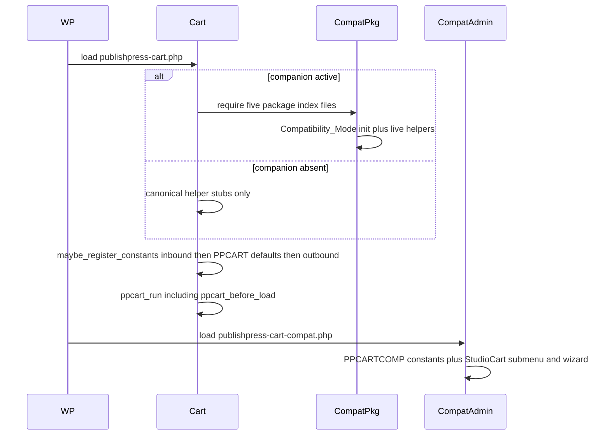

# PublishPress Cart Compatibility — Architecture

Runtime map of this companion plugin: StudioCart Compatibility Mode shims and
merchant Data migration. It does not replace PublishPress Cart and is not a
live StudioCart integration.

**Principles**

- Packages load from Cart’s plugin file when this companion is active, **before**
  `PPCART_*` defaults and `ppcart_run()`. The companion main file only wires
  admin UI and WP-CLI.
- Canonical Cart stays `PPCart_*` / `ppcart_*` / `PPCART_*`. Leftover
  `sc_*` / `NCS_*` PHP names live only here.
- **No silent data migration.** Leftover storage stays in place until a merchant
  clicks Data migration. Compatibility Mode and boot must not copy, rename, or
  delete those rows.
- Move code; do not rewrite public APIs. New PHP files: one concern, under 500
  lines.

Feature records: [docs/features/](../features/). Extract history:
[extract-from-cart.md](extract-from-cart.md).

---

## Bootstrap flow



### Companion main file

[`publishpress-cart-compat.php`](../../publishpress-cart-compat.php):

1. PHP / WordPress version gates (`PPCARTCOMP_MINIMUM_PHP_VERSION` 7.4,
   `PPCARTCOMP_MINIMUM_WP_VERSION` 6.7). One bootstrap `global $wp_version`.
2. Refuse to load beside leftover Studiocart (`PPCartComp_Studiocart_Conflict`).
3. Define `PPCARTCOMP_*` (`LOADED`, `VERSION`, `BASE_FILE`, `BASE_DIR`, `BASE_URL`).
4. `ppcartcomp_cart_is_loaded()` is `defined('PPCART_FREE_LOADED') ||
   defined('PPCART_VERSION')`. Do **not** use `Requires Plugins:
   publishpress-cart` in the PHP header — Pro vendors Free and that slug is not
   active on Pro-only sites.
5. `plugins_loaded` priority 5 → `ppcartcomp_run()`: missing-Cart admin notice,
   or StudioCart submenu + Data migration wizard.
6. `cli_init` → seed-migration WP-CLI command.

Packages are **not** required from this file. Cart already loaded them.

### Cart early include

When `publishpress-cart-compat/publishpress-cart-compat.php` is in
`active_plugins` or network-enabled, Cart
`ppcart_companion_plugin_dir()` + `ppcart_load_companion_compat_packages()`
`require_once` these paths from `WP_PLUGIN_DIR . '/publishpress-cart-compat/'`,
in this order, **before** `PPCART_*` defaults:

1. `includes/compat/studiocart-compatibility-mode/index.php` (also loads
   `option-key-migration`, calls `PPCartComp_Studiocart_Compatibility_Mode::init()`)
2. `includes/compat/cpt-slug-migration/index.php`
3. `includes/compat/meta-key-migration/index.php`
4. `includes/compat/shortcode-tag-migration/index.php`
5. `includes/compat/custom-table-migration/bootstrap.php`

Then Cart loads canonical live-helper stubs (`function_exists` so companion
implementations win), runs inbound `maybe_register_constants()`, defines
`PPCART_*`, runs outbound `maybe_register_constants()`, then `ppcart_run()`
which fires `ppcart_before_load`.

`PPCart::__construct()` calls `ppcart_register_live_meta_table()`,
`ppcart_query_post_types()`, and `ppcart_before_load` **before** any later
plugin file can run. Compatibility Mode `init()` must already have hooked
`ppcart_before_load`.

Cart keeps canonical-only stubs for unguarded helpers Pro/Free already call:
`ppcart_meta_key()`, `ppcart_live_table()`, `ppcart_live_post_type()`,
`ppcart_query_post_types()`, `ppcart_live_taxonomy()`, `ppcart_live_cap()`,
`ppcart_live_role()`, `ppcart_user_can()`, `ppcart_register_live_meta_table()`.
Without this companion, leftover CPT/table rows look missing.

---

## Compatibility Mode

Gate: `PPCartComp_Studiocart_Compatibility_Mode::is_enabled()`. Default **off**.
Merchant option `_ppcart_compatibility_mode`; historical toggle rows are
read-only Compat inputs. wp-config `PPCART_STUDIOCART_COMPATIBILITY_MODE`
overrides the checkbox.

When on, the package registers leftover class aliases, function wrappers, hook
bridges, option/meta API bridges, constant aliases, runtime-global aliases,
shortcode tags, request-field copies, Stripe metadata lookup, CPT/taxonomy/FSE
names, and public URL redirects. First-party Cart must not call these shims.
Runtime gate for extensions: `ppcart_cart_supports( 'ppcart-compatibility-mode' )`
(filter `ppcart_cart_supports_feature` at priority 20). The prior feature id is
accepted only by Compat while the mode is enabled.

Function wrappers load from `functions/index.php` **only** when the mode is on
(`maybe_register_functions()`). Bodies are one-line delegates to `ppcart_*`.

Cron hook drain bridges register even when the mode is off so leftover
`wp_cron` hook names still reach canonical handlers.

Feature record: [ppcart-compatibility-mode.md](../features/ppcart-compatibility-mode.md).

---

## Data migration

Merchant-run leftover rewrites. Each package boots admin/AJAX on
`plugins_loaded`; none of them migrate on activate, boot, or Compatibility Mode
toggle.

| Package | Path | What the merchant step does |
|---------|------|-----------------------------|
| CPT slugs | `includes/compat/cpt-slug-migration/` | Rename leftover CPT/taxonomy/cap/role slugs; reverse-map backup |
| Meta keys | `includes/compat/meta-key-migration/` | Rewrite leftover `_sc_*` post/user meta names |
| Shortcode tags | `includes/compat/shortcode-tag-migration/` | Rewrite leftover shortcode **content** in posts and email options |
| Option keys | `includes/compat/option-key-migration/` | Copy leftover option/transient rows onto canonical keys |
| Custom tables | `includes/compat/custom-table-migration/` | `RENAME TABLE` leftover `ncs_*` tables; alter order-item meta column |

Wizard UI: `includes/admin/class-ppcartcomp-data-migration-wizard.php` plus
React assets under `assets/admin/migration-wizard/`. Screen: Cart → StudioCart
(`page=ppcart-studiocart`).

Chunked leftover SQL uses `$wpdb` directly (backup tables, `RENAME TABLE`,
row rewrites). That is the domain, not accidental coupling. Do not “eliminate
all SQL.”

Feature record: [data-migration.md](../features/data-migration.md).

---

## Folder map

| Path | Role |
|------|------|
| `publishpress-cart-compat.php` | Bootstrap, `PPCARTCOMP_*`, admin/CLI entry |
| `includes/class-ppcartcomp-studiocart-conflict.php` | Refuse to load beside leftover Studiocart |
| `includes/admin/` | StudioCart submenu, Data migration wizard |
| `includes/admin/templates/studiocart-page.php` | Admin screen markup |
| `includes/cli/` | `wp ppcartcomp seed-migration` |
| `includes/ppcartcomp-drop-migration-backups.php` | Optional uninstall drop of reverse-map backup tables |
| `assets/admin/migration-wizard/` | Wizard React source + build |
| `includes/compat/studiocart-compatibility-mode/` | PHP shims (see below) |
| `includes/compat/cpt-slug-migration/` | CPT/taxonomy/cap/role Data migration |
| `includes/compat/meta-key-migration/` | Post/user meta Data migration + leftover meta API bridges |
| `includes/compat/shortcode-tag-migration/` | Stored shortcode-tag Data migration |
| `includes/compat/option-key-migration/` | Option/transient key Data migration (explicit copy only) |
| `includes/compat/custom-table-migration/` | Custom table rename + live table helpers |

### Compatibility Mode package

```
includes/compat/studiocart-compatibility-mode/
  index.php
  class-ppcartcomp-studiocart-compatibility-mode.php   # settings, gates, maybe_register_*
  class-ppcartcomp-studiocart-public-query-compatibility.php
  aliases.php, constants.php, globals.php
  options.php, ajax.php, request-fields.php, stripe-metadata.php
  cpt-taxonomy.php, shortcodes.php
  functions/           # lazy-loaded ncs_* / sc_* wrappers (index.php + shards)
  hooks.php            # thin shim → hooks/index.php
  hooks/               # map-config, state, runtime, attach, state-store, register
  maps/*.php           # canonical => leftover name maps
  css/                 # leftover admin/public selectors
```

`hooks.php` is a one-line require of `hooks/index.php` so Cart’s early include
and existing `require` paths stay stable.

---

## Prefixes

Companion-owned symbols: `PPCartComp_`, `ppcartcomp_`, `PPCARTCOMP_`. Files:
`class-ppcartcomp-*.php`. Cart live helpers and stored option keys stay
`ppcart_*` / `_ppcart_*`. See [AGENTS.md](../../AGENTS.md).
