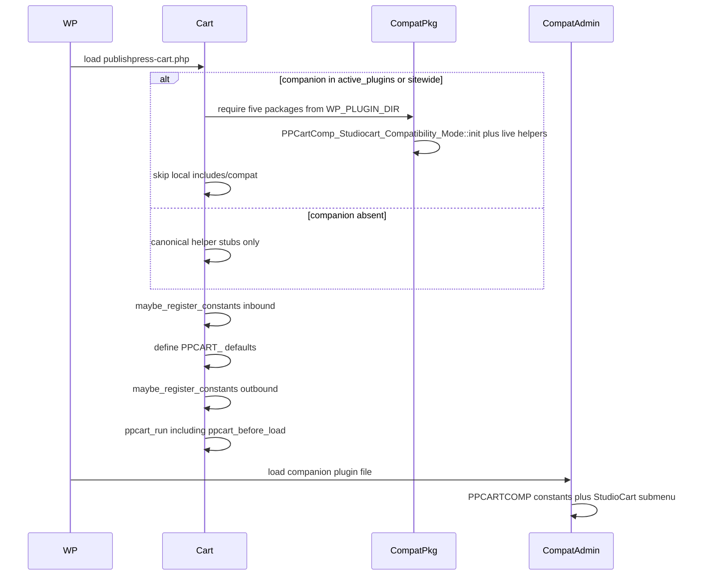

# Extract Compatibility Mode and Data migration from Cart

How StudioCart Compatibility Mode and merchant Data migration live in this
companion plugin (`publishpress-cart-compat`) after the extract from
PublishPress Cart Free.

**Status:** Landed. Packages live here. Cart must not keep copies. Leftover-store
sites must activate this companion **before** updating Cart.

**Scope:** Companion (`publishpress-cart-compat`) + Cart Free (`publishpress-cart`).
Pro vendors Free and must not receive these shims.

**Prefix:** Companion-owned classes, functions, constants, and PHP files use
`ppcartcomp` (see [Prefixes](#prefixes)). Cart live helpers that Free/Pro already
call stay `ppcart_*`.

Runtime map: [architecture.md](architecture.md).

---

## Goals (met)

1. Cart Free has no StudioCart Compatibility Mode package and no Data migration
   UI. Leftover `sc_*` / `NCS_*` PHP names live only in this companion.
2. The StudioCart **admin item is a submenu of Cart**, not a Cart Settings tab
   and not a top-level menu.
3. Unmigrated leftover stores keep working **only when this companion is
   active**. Cart without the companion is canonical-only.
4. Cart loads companion packages early; it does not `require` a local
   `includes/compat/`.

---

## Prefixes

Do not use `PPCART_COMPAT_`, `PPCart_Compat_`, or `ppcart_compat_`.
Text domain and slug stay `publishpress-cart-compat`.

| Kind | Form | Example |
|------|------|---------|
| Classes | `PPCartComp_` | `PPCartComp_Cpt_Slug_Migrator` |
| Functions (companion-owned) | `ppcartcomp_` | `ppcartcomp_run` |
| Constants (companion-owned) | `PPCARTCOMP_` | `PPCARTCOMP_VERSION` |
| Files | `class-ppcartcomp-{kebab}.php` | `class-ppcartcomp-cpt-slug-migrator.php` |

Moved package classes were renamed on copy
(`PPCart_Studiocart_Compatibility_Mode` →
`PPCartComp_Studiocart_Compatibility_Mode`, `class-ppcart-*.php` →
`class-ppcartcomp-*.php`).

Cart live helpers and stored option keys that Free/Pro already call stay
`ppcart_*` / `_ppcart_*` (stubs in Cart; real implementations in this plugin
behind `function_exists`). Merchant option
`_ppcart_studiocart_compatibility_mode` and wp-config
`PPCART_STUDIOCART_COMPATIBILITY_MODE` stay (stored contract).

---

## Runtime contract

**Do not use `Requires Plugins: publishpress-cart` in the PHP header.** Pro
vendors Free via Composer; slug `publishpress-cart` is not active on Pro-only
sites, so WordPress would block this companion. Gate on
`defined('PPCART_FREE_LOADED') || defined('PPCART_VERSION')` and bail if Cart is
missing (`ppcartcomp_cart_is_loaded()`).

**Early include (not constants-only):** when this plugin is in `active_plugins`
or network-enabled, Cart `require_once`s from
`WP_PLUGIN_DIR . '/publishpress-cart-compat/'` these five paths, in this order,
**before** `PPCART_*` defaults and **before** `ppcart_run()`:

1. `includes/compat/studiocart-compatibility-mode/index.php` (also loads
   `option-key-migration`, calls `init()`)
2. `includes/compat/cpt-slug-migration/index.php`
3. `includes/compat/meta-key-migration/index.php`
4. `includes/compat/shortcode-tag-migration/index.php`
5. `includes/compat/custom-table-migration/bootstrap.php`

Then `maybe_register_constants()` (inbound), define `PPCART_*`, then
`maybe_register_constants()` again (outbound). Inbound leftover wp-config
constants still only apply when Compatibility Mode is on
(`maybe_register_constants` is gated by `is_enabled()`).

**Why:** `PPCart::__construct()` / hook registrar run at the end of Cart’s
plugin file. They call `ppcart_register_live_meta_table()`,
`ppcart_query_post_types()`, and `ppcart_before_load` **before** any later
plugin file can run. `PPCartComp_Studiocart_Compatibility_Mode::init()` must
already have hooked `ppcart_before_load`.

**Skip local:** Cart must **not** `require` its own `includes/compat/*`.
`require_once` is per path; two copies of the same class will fatal.

**Companion main file:** `PPCARTCOMP_*`, StudioCart submenu, `function_exists` /
`class_exists` guards. Packages are already loaded by Cart.

**Cart stubs (public contract):** Free keeps canonical-only implementations of
helpers core calls **unguarded**: `ppcart_meta_key()`, `ppcart_live_table()`,
`ppcart_live_post_type()`, `ppcart_query_post_types()`, `ppcart_live_taxonomy()`,
`ppcart_live_cap()`, `ppcart_live_role()`, `ppcart_user_can()`,
`ppcart_register_live_meta_table()`. Companion real helpers load first via the
early include (`function_exists` in the stub files so they do not redeclare).
Pro must keep calling these symbols in Free; do not vendor shims into Pro.

**Call sites in Cart:** pass **family keys** (`product`, `cart_manager`,
`manager_option`), not leftover strings (`sc_cart_manager`, `edit_sc_products`).

**Unmigrated stores:** without this companion, leftover CPT/table rows look
missing (canonical stubs). Leftover stores must **activate this companion before
updating Cart**.

Keep Cart extension points: `ppcart_before_load`, `ppcart_cart_supports_feature`,
`ppcart_stripe_metadata_compatibility_lookup()` in Cart
`includes/helpers/ppcart-stripe-metadata.php`. Do not move that helper.

---

## What landed

Trees that used to live in Cart `includes/compat/` now live here (same folder
names):

- `studiocart-compatibility-mode/`
- `option-key-migration/`
- `cpt-slug-migration/`
- `meta-key-migration/`
- `shortcode-tag-migration/`
- `custom-table-migration/`

Also here: feature records, `.cursor/skills/studiocart-compatibility-mode/`,
catalog cases for companion assertions, and the matching Codeception files.

**StudioCart is a submenu of Cart**, parent
`PPCart_Admin_Screens::PAGE_DASHBOARD` (`ppcart`). Contents: Compatibility Mode
checkbox (option `_ppcart_studiocart_compatibility_mode`, wp-config
`PPCART_STUDIOCART_COMPATIBILITY_MODE`) plus the Data migration wizard.

Companion WPLoader activates **both** plugins (sibling `../publishpress-cart`).
Cart’s suite must pass **without** this companion. IT/UT ids were kept.

---

## Leftover Cart-side notes

These are out of the companion extract; do not treat them as unfinished
cutover of these packages:

- jQuery `studiocart/orderform/*`, privacy exporter `studiocart_exporter`,
  marketing URLs, leftover `add_option__sc_*` hooks in Cart
  `includes/bootstrap/templates/admin-hook-registrar-register.php`
- Cart scanners that stay in Free (`prefix-leftover-literals`, HTML ids,
  method names, JS globals, admin screen slugs, REST namespace)
- First-party Stripe key and CPT string tests in Cart
- Product-duplicate tests that require CPT/meta helpers stay in Cart

Cart hook-prefix / constant-prefix policy scripts must not glob companion maps.
This plugin’s PHPCS must **allow** leftover names (they are the product).
