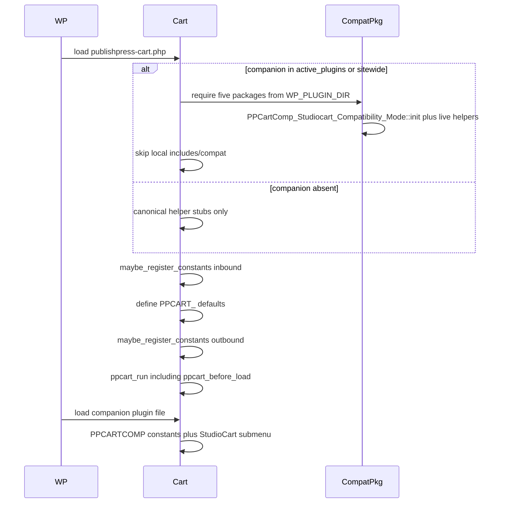

# Extract Compatibility Mode and Data migration from Cart

Implementation guide for moving StudioCart Compatibility Mode and merchant Data
migration out of PublishPress Cart Free into this companion plugin
(`publishpress-cart-compat`).

**Status:** Not started. Skeleton plugin exists; packages still live in Cart.

**Scope:** Companion (`publishpress-cart-compat`) + Cart Free (`publishpress-cart`).
Pro vendors Free and must not receive these shims.

**Prefix:** Companion-owned classes, functions, constants, and PHP files use
`ppcartcomp` (see [Prefixes](#prefixes)). Cart live helpers that Free/Pro already
call stay `ppcart_*`.

Reviewed against Cart bootstrap (load order, unguarded helpers, Pro
`Requires Plugins` trap). Do not load live helpers only from the companion
plugin file.

---

## Goals

1. Cart Free has no StudioCart Compatibility Mode package and no Data migration
   UI. Leftover `sc_*` / `NCS_*` PHP names live only in this companion.
2. The StudioCart **admin item is a submenu of Cart**, not a Cart Settings tab
   and not a top-level menu.
3. Unmigrated leftover stores keep working **only when this companion is
   active**. Cart without the companion is canonical-only.
4. Two PRs, same merge window: companion gains the packages; Cart stops loading
   its copies.

---

## Prefixes

Do not use `PPCART_COMPAT_`, `PPCart_Compat_`, or `ppcart_compat_`.
Text domain and slug stay `publishpress-cart-compat`.

| Kind | Form | Example |
|------|------|---------|
| Classes | `PPCartComp_` | `PPCartComp_Cpt_Slug_Migrator` |
| Functions (companion-owned) | `ppcartcomp_` | `ppcartcomp_run` |
| Constants (companion-owned) | `PPCARTCOMP_` | `PPCARTCOMP_VERSION` |
| Files | `class-ppcartcomp-{kebab}.php` | `class-ppcartcomp-cpt-slug-migrator.php` |

Rename moved package classes and basenames on copy
(`PPCart_Studiocart_Compatibility_Mode` →
`PPCartComp_Studiocart_Compatibility_Mode`, `class-ppcart-*.php` →
`class-ppcartcomp-*.php`).

Cart live helpers and stored option keys that Free/Pro already call stay
`ppcart_*` / `_ppcart_*` (stubs in Cart; real implementations in this plugin
behind `function_exists`). Merchant option
`_ppcart_studiocart_compatibility_mode` and wp-config
`PPCART_STUDIOCART_COMPATIBILITY_MODE` stay (stored contract).

---

## Runtime contract

**Do not use `Requires Plugins: publishpress-cart`.** Pro vendors Free via
Composer; slug `publishpress-cart` is not active on Pro-only sites, so WordPress
would block this companion. Gate on `defined('PPCART_FREE_LOADED') ||
defined('PPCART_VERSION')` and bail if Cart is missing.

**Early include (not constants-only):** when this plugin is in `active_plugins`
or network-enabled, Cart `require_once`s from
`WP_PLUGIN_DIR . '/publishpress-cart-compat/'` the **same five paths Cart uses
today**, in the same order, **before** `PPCART_*` defaults and **before**
`ppcart_run()`:

1. `includes/compat/studiocart-compatibility-mode/index.php` (also loads
   `option-key-migration`, calls `init()`)
2. `includes/compat/cpt-slug-migration/index.php`
3. `includes/compat/meta-key-migration/index.php`
4. `includes/compat/shortcode-tag-migration/index.php`
5. `includes/compat/custom-table-migration/bootstrap.php`

Then `maybe_register_constants()` (inbound), define `PPCART_*`, then
`maybe_register_constants()` again (outbound). Same two-phase as Cart
`publishpress-cart.php`. Inbound leftover wp-config constants still only apply
when Compatibility Mode is on (`maybe_register_constants` is gated by
`is_enabled()`). That matches today.

**Why:** `PPCart::__construct()` / hook registrar run at the end of Cart’s
plugin file. They call `ppcart_register_live_meta_table()`,
`ppcart_query_post_types()`, and `ppcart_before_load` **before** any later
plugin file can run. `PPCartComp_Studiocart_Compatibility_Mode::init()` must
already have hooked `ppcart_before_load`.

**Skip local:** if the companion path was loaded, Cart must **not** `require`
its own `includes/compat/*`. `require_once` is per path; two copies of the same
class will fatal. `class_exists` around companion `init()` would hide the new
admin during overlap.

**Companion main file:** `PPCARTCOMP_*`, StudioCart submenu, `function_exists` /
`class_exists` guards. Packages are already loaded by Cart.

**Cart stubs (public contract):** Free keeps canonical-only implementations of
helpers core calls **unguarded**: `ppcart_meta_key()`, `ppcart_live_table()`,
`ppcart_live_post_type()`, `ppcart_query_post_types()`, `ppcart_live_taxonomy()`,
`ppcart_live_cap()`, `ppcart_live_role()`, `ppcart_user_can()`,
`ppcart_register_live_meta_table()`. Companion real helpers load first via the
early include (`function_exists` in the stub files so they do not redeclare).
Pro must keep calling these symbols in Free; do not vendor shims into Pro.

**Call sites in Cart:** pass **family keys** (`product`, `cart_manager`,
`manager_option`), not leftover strings (`sc_cart_manager`, `edit_sc_products`).
Gutenberg / activator leftover fallbacks become canonical family keys.

**Unmigrated stores:** without this companion, leftover CPT/table rows look
missing (canonical stubs). Leftover stores must **activate this companion before
updating Cart**. Companion activation can run leftover-aware setup. Optional Cart
notice uses only canonical option keys (compat toggle on or incomplete migration
state).

Keep Cart extension points: `ppcart_before_load`, `ppcart_cart_supports_feature`,
`ppcart_stripe_metadata_compatibility_lookup()` in Cart
`includes/helpers/ppcart-stripe-metadata.php`. Do not move that helper.

---

## What moves (entire trees)

From Cart `includes/compat/` into this plugin (keep folder names):

- `studiocart-compatibility-mode/`
- `option-key-migration/`
- `cpt-slug-migration/`
- `meta-key-migration/`
- `shortcode-tag-migration/`
- `custom-table-migration/`

Also move: feature record, `.cursor/skills/studiocart-compatibility-mode/`,
catalog cases **for moved assertions**, and the Codeception files listed under
Tests.

---

## Companion admin (inside Cart menu)

**StudioCart is a submenu of Cart**, parent
`PPCart_Admin_Screens::PAGE_DASHBOARD` (`ppcart`). It is not Cart Settings →
StudioCart and not a top-level “StudioCart” menu.

Contents: Compatibility Mode checkbox (option
`_ppcart_studiocart_compatibility_mode`, wp-config
`PPCART_STUDIOCART_COMPATIBILITY_MODE`) plus the four Data migration cards.

Retarget enqueue/AJAX off `is_settings_screen` / `SETTINGS_TAB = 'studiocart'` /
`settings_url()` `#studiocart`. Move `bindCustomTableMigration` out of Cart
`admin/js/ppcart-settings.js`. Package `admin.js` files move with the trees.

Strip the StudioCart **settings tab** from Cart:

- `admin/partials/ppcart-admin-page-settings.php`
- `admin/partials/settings-page/tabs/panels.php`
- `admin/partials/settings-page/render-helpers.php`
- `admin/partials/settings-page/metadata.php`

Stop `ppcart_register_sections` / `_ppcart_option_list` for this feature.
Rewrite IT-274 (legacy migration page redirect) for the new Cart submenu screen.

---

## Cart cleanup

- Skip-local `includes/compat/*` in the same merge as companion admin; then
  delete the directory.
- Drop compat requires from unit `_bootstrap.php`.
- Family-key call sites; canonical stubs.
- Hook-prefix / constant-prefix policy scripts
  (`tests/bin/hook-prefix-policy.php`, `hook-manifest.php`,
  `constant-prefix-policy.php`, `rename-hook-prefixes.php`,
  `composer test:integration:prefix`) currently glob
  `includes/compat/studiocart-compatibility-mode/`. Split: Cart = no leftover
  fires in first-party; companion owns maps. Regen Cart
  `docs/hooks-manifest.json`.
- This plugin needs its own `.phpcs.xml` that **allows** leftover names (they
  are the product). Cart plugin-review sniff is fine after delete.

**Out of this cutover:** jQuery `studiocart/orderform/*`, privacy exporter
`studiocart_exporter`, marketing URLs, `$studiocart` / `$sc_product_fields` /
`$scFiles` globals, leftover `add_option__sc_*` hooks in Cart
`includes/bootstrap/templates/admin-hook-registrar-register.php`. Same leftover
bucket; do not claim Free is leftover-clean after this PR.

---

## Tests — split by assertion, not feature tag

Do **not** move every Cart `.tests.config.yaml` module with
`features: [studiocart-compatibility-mode]`. Those mix Cart scanners with
companion shims.

**Stay in Cart**

- Scanners: `prefix-leftover-literals` UT-230, `prefix-html-ids`,
  `prefix-method-names`, `prefix-js-globals`, `prefix-dashboard-widget`,
  `prefix-admin-screen-slugs`, `prefix-rest-namespace`
- `prefix-stripe-metadata` **UT-235** (first-party Stripe keys)
- `prefix-cpt-taxonomy-strings` **UT-236** (first-party CPT strings)
- First-party halves of `prefix-shortcode-usage`, `prefix-functions`,
  `prefix-hooks`
- Admin screens, product-duplicate, checkout-block: **update** leftover
  `sc_product` assumptions to canonical/stubs; do not move
- `order-management` UT-202 if still listed there after options module moves
- New unit: `includes/compat` is gone

**Move to this plugin**

- `legacy-compat` (except Cart “dir gone”)
- Compat-on halves: options, meta leftover lookup, function wrappers, hook
  bridges, constants, compat-class, runtime-globals, public-query-vars, ajax
  leftover, request-fields, Stripe leftover lookup, shortcode dual-register
- Class-alias modules: `prefix-public`, `prefix-helpers`, `prefix-admin`,
  `prefix-admin-controllers`, `prefix-stripe-logging`, `prefix-bootstrap`,
  `prefix-fixtures`
- `prefix-shortcode-tag-migration`, `prefix-cpt-slugs` (UT-200, IT-269–274),
  custom-table migration (UT-220, IT-300–305)
- `prefix-transients` leftover `_transient_sc_*` read-through + explicit
  Data migration copy (`option-key-migration/`; never boot-copy);
  Cart canonical transient tests stay
- `CptSlugMigrationTestCase.php`, `Unit/Compat/*`, `Integration/Compat/*`,
  migration Prefix/CustomTables PHP

Companion WPLoader activates **both** plugins (sibling `../publishpress-cart`).
Cart suite after delete must pass **without** this companion. Keep IT/UT ids.

Product-duplicate tests that require CPT/meta helpers stay in Cart and must be
fixed, not moved.

---

## Work items

1. Copy `includes/compat` trees + feature/skill; rename to `PPCartComp_` /
   `class-ppcartcomp-*`; companion main file is `PPCARTCOMP_*` + admin +
   `class_exists` guards.
2. Cart: when companion is active, require all five packages from
   `WP_PLUGIN_DIR` before `PPCART_*` defaults and before `ppcart_run()`; skip
   local `includes/compat`.
3. Canonical-only stubs in Free for unguarded helpers.
4. StudioCart submenu under Cart `ppcart`; retarget enqueue/AJAX; strip Settings
   → StudioCart (including render-helpers and metadata).
5. Delete Cart `includes/compat` after skip-local; family keys not `sc_*` at
   call sites; drop settings.js custom-table binder.
6. Split tests by assertion; both plugins in companion WPLoader; update
   hook-manifest / prefix scripts.
7. Docs: Pro helper symbols stay in Free; no `Requires Plugins`; leftover-store
   upgrade order; both `AGENTS.md` files; Cart `prefix-standardization.md` and
   features README.

---

## Landing

1. Companion PR: packages + StudioCart submenu + tests. Incomplete until Cart
   skip-local exists.
2. Cart PR in the **same merge window**: early include of all five packages,
   skip local, stubs, Settings tab gone, tests split, hook-manifest. Do not
   verify the new submenu while Cart still loads its own copies (fatal or Cart
   wins).
3. Leftover-store upgrade: this companion on **before** Cart update.

Activate this plugin on a DDEV site only after both PRs.
